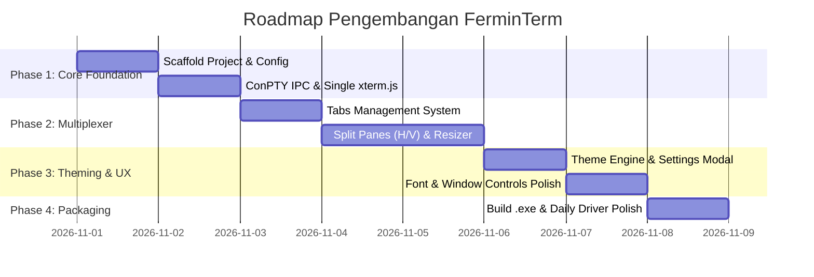

# Product Requirements Document (PRD)
# Projek: FerminTerm

**Versi Dokumen:** 1.1.0  
**Status:** Approved for Development  
**Tanggal:** November 2026  
**Author:** FerminTerm Core Contributors  
**Target Platform:** Windows 11 Desktop (`win32-x64`)  
**Lisensi:** MIT Open Source Ready

---

## 1. Executive Summary & Vision

**FerminTerm** adalah aplikasi desktop *terminal multiplexer* dan *agent workspace* modern, berperforma tinggi, dan berkelas yang dirancang untuk pengembang dan data scientist di Windows 11.

Terinspirasi dari alur kerja developer modern (seperti **Orca** di `onorca.dev`, Warp, dan tmux), FerminTerm menggabungkan:
1. Kecepatan dan stabilitas engine native **Windows ConPTY**.
2. Fleksibilitas tata letak layar (**Tabs & Dynamic Split Panes**).
3. Estetika visual premium (**Anti AI-Slop**, hairline borders, typography kasta atas).
4. Kemudahan personalisasi (**Dual-Sync Theme Engine** dengan 12 tema legendaris developer).
5. Kesiapan arsitektur untuk orkestrasi AI Coding Agents (Git Worktree & Diff Inspector) di fase berikutnya.

---

## 2. User Persona & Scope

### 2.1 User Profile
* **Target User**: Developer, Data Scientist, dan Power User.
* **Workstation**: Windows 11 Pro/Home (`win32 10.0.26200+`), Node.js v24, Bun 1.4, Python 3.13, Git 2.54.
* **Kebutuhan**: Buka banyak shell sekaligus, navigasi cepat tanpa mouse, visual rapi tanpa distraksi, responsivitas tinggi saat menjalankan script berat maupun coding agents.

### 2.2 Scope & Batasan
* **In-Scope**:
  * Aplikasi desktop Windows mandiri (frameless window).
  * ConPTY backend dengan default shell **PowerShell** (mendukung CMD, Git Bash, WSL).
  * Sistem multi-tab dan split-pane fleksibel (horizontal & vertikal) dengan draggable resizer.
  * Engine ganti tema instan (sync ke UI + xterm ANSI palette).
  * Pengaturan tersimpan secara persisten.
* **Out-of-Scope (Fase Ini)**:
  * Dukungan macOS/Linux (fokus 100% optimal di Windows 11).
  * Multi-user auth / cloud sync / telemetri komersial.

---

## 3. Arsitektur Teknis & Stack

Aplikasi menggunakan pola **Secure 3-Tier Electron Architecture**:

```
┌─────────────────────────────────────────────────────────────┐
│                 RENDERER PROCESS (React 19)                 │
│  - xterm.js (WebGL/Canvas Addon, FitAddon, WebLinks)        │
│  - Tailwind CSS + Lucide Icons                              │
│  - Multiplexer State Tree (Tabs -> Split Nodes -> Panes)    │
│  - Theme Context & Settings Modal                           │
└──────────────────────────────┬──────────────────────────────┘
                               │ IPC (Context Isolation / Typed Bridge)
┌──────────────────────────────▼──────────────────────────────┐
│                       PRELOAD SCRIPT                        │
│  - window.ferminAPI (createTerm, sendInput, resize, kill)   │
└──────────────────────────────┬──────────────────────────────┘
                               │ Native IPC
┌──────────────────────────────▼──────────────────────────────┐
│                    MAIN PROCESS (Node.js)                   │
│  - BrowserWindow (Frameless, Custom Titlebar, Win Controls) │
│  - node-pty Manager (Windows ConPTY API)                    │
│  - Process Lifecycle & Session Store                        │
└─────────────────────────────────────────────────────────────┘
```

### Tech Stack:
* **Shell Desktop**: Electron (latest) + Vite + `vite-plugin-electron`
* **Frontend UI**: React (TypeScript), Tailwind CSS, Lucide React
* **Terminal Engine**: `node-pty` (ConPTY bindings untuk Windows)
* **Terminal UI**: `@xterm/xterm`, `@xterm/addon-fit`, `@xterm/addon-webgl`, `@xterm/addon-web-links`
* **Font**: Cascadia Code / JetBrains Mono

---

## 4. Functional Requirements (FR)

### FR-1: Terminal Core & ConPTY Engine
* **FR-1.1**: Default otomatis spawn shell `powershell.exe` saat app atau pane baru dibuka.
* **FR-1.2**: Komunikasi stream 2 arah (PTY stdout -> xterm display, xterm onData -> PTY stdin) dengan latency < 16ms.
* **FR-1.3**: Auto-resize PTY cols/rows secara realtime saat ukuran jendela atau pane berubah (via `FitAddon`).
* **FR-1.4**: Bersihkan proses PTY di OS saat pane ditutup (mencegah zombie processes).

### FR-2: Tab Management
* **FR-2.1**: Kemampuan menambah tab baru (`Ctrl+T` atau tombol `+` di titlebar).
* **FR-2.2**: Menutup tab aktif (`Ctrl+W`).
* **FR-2.3**: Berpindah antar-tab via shortcut keyboard (`Ctrl+Tab`, `Ctrl+1` s/d `Ctrl+9`).
* **FR-2.4**: Rename label tab dengan double click.
* **FR-2.5**: Tiap tab memiliki *state layout split-pane* yang independen.

### FR-3: Dynamic Split-Pane Multiplexer
* **FR-3.1**: Split horizontal (`Ctrl+Shift+D`): Membagi pane aktif menjadi atas & bawah.
* **FR-3.2**: Split vertikal (`Ctrl+Shift+E`): Membagi pane aktif menjadi kiri & kanan.
* **FR-3.3**: Draggable Splitter Handle: Garis pemisah bisa digeser dengan mouse untuk mengatur proporsi lebar/tinggi pane secara bebas.
* **FR-3.4**: Active Pane Focus Ring: Pane yang sedang menerima input keyboard memiliki highlight border halus (misal: cyan/accent glow).
* **FR-3.5**: Tutup pane individual (`Ctrl+Shift+W` atau tombol close di pane header).

### FR-4: Shell Profile Selector
* **FR-4.1**: Dropdown cepat di tab atau header pane untuk memilih jenis shell:
  * PowerShell 7 / Windows PowerShell (Default)
  * Command Prompt (`cmd.exe`)
  * Git Bash (`bash.exe`)
  * WSL (`wsl.exe`)

### FR-5: Dual-Sync Theming Engine & Settings
* **FR-5.1**: Panel Pengaturan (Settings Modal) dapat diakses via shortcut `Ctrl+,` atau icon gear.
* **FR-5.2**: Opsi tema yang didukung (12 tema legendaris developer):
  1. **Fermin Obsidian (Default)**: Deep matte black (`#0c0e12`), aksen electric cyan, kontras tinggi.
  2. **Midnight Garnet**: Deep velvet navy (`#070b19`), aksen carmine garnet & gold.
  3. **Catppuccin Mocha**: Skema warna pastel gelap modern, nyaman di mata.
  4. **Tokyo Night**: Cyberpunk elegan, nuansa biru malam dengan teks neon lembut.
  5. **One Dark Pro**: Tema legendaris VS Code/Atom.
  6. **Dracula Pro, Gruvbox, Nord Arctic, Rosé Pine, Monokai Pro, Solarized Dark, Matrix**.
* **FR-5.3**: Perubahan tema langsung menyinkronkan dua layer secara realtime:
  * Layer Frame UI (background app, tab bar, border pane, tombol, scrollbar).
  * Layer Engine `xterm.js` (background terminal, foreground teks, kursor, selection, dan 16 warna standar ANSI).
* **FR-5.4**: Menyimpan tema terpilih ke local persistence (`localStorage` / config json).

#### 4.5.1 Spesifikasi Tema: Midnight Garnet
Tema ini dirancang dengan standar kemewahan tinggi (Anti AI-Slop):
* **UI Frame & Canvas Palette**:
  * `Background Base`: `#070b19` (Deep pitch midnight navy)
  * `Panel & Card Surface`: `#0b1226` (Subtle stadium blue-black)
  * `Hairline Borders`: `1px solid rgba(0, 77, 152, 0.25)`
  * `Active Pane Focus Ring`: Dual-tone gradient border (`#004d98` ke `#a50044`) dengan aksen sudut gold (`#edbb00`).
  * `Tab Active Indicator`: Garis bawah 2px gradient.
* **xterm.js ANSI & Terminal Palette**:
  * `Background`: `#070b19`
  * `Foreground`: `#e6ebf5` (Crisp ice white, kontras tinggi anti capek)
  * `Cursor`: `#edbb00` (Gold █, solid & blinking mode)
  * `Cursor Accent`: `#070b19`
  * `Selection Background`: `rgba(165, 0, 68, 0.38)` (Deep Garnet tint)
  * `Colors 16-ANSI`:
    * Black: `#141d38` | Bright Black: `#384975`
    * Red: `#ff4b6e` | Bright Red: `#ff6b8b` (Garnet highlight)
    * Green: `#00e5a3` | Bright Green: `#26ffbe`
    * Yellow: `#edbb00` | Bright Yellow: `#ffd043`
    * Blue: `#0084ff` | Bright Blue: `#4dabf7`
    * Magenta: `#a50044` | Bright Magenta: `#c71f5f`
    * Cyan: `#00d2d3` | Bright Cyan: `#48dbfb`
    * White: `#e6ebf5` | Bright White: `#ffffff`
### FR-6: Custom Frameless Window
* **FR-6.1**: Window tanpa border default Windows yang kaku; menggunakan custom titlebar terintegrasi.
* **FR-6.2**: Titlebar berisi identitas FerminTerm, Tab Bar, tombol New Tab, Settings, dan Window Controls (Minimize, Maximize/Restore, Close).
* **FR-6.3**: Drag region yang luas untuk memudahkan menggeser posisi jendela.

---

## 5. Non-Functional Requirements (NFR)

* **NFR-1 (Performa & Latensi)**: Render 60 FPS menggunakan akselerasi WebGL/Canvas; tidak ada input lag saat ngetik command cepat atau menjalankan script streaming teks panjang.
* **NFR-2 (Desain Anti AI-Slop)**: Menggunakan rasio kontras proporsional, border tipis presisi (`1px hairline`), padding konsisten, dan tipografi tajam tanpa dekorasi gradien generik.
* **NFR-3 (Efisiensi Memori)**: Penggunaan RAM ditekan serendah mungkin dengan membersihkan event listener dan buffer terminal saat pane ditutup.
* **NFR-4 (Keandalan)**: Jika sebuah proses shell crash atau selesai (`process exit`), UI tetap stabil dan menampilkan notifikasi restart pane, bukan merusak layout aplikasi.

---

## 6. Roadmap & Milestone Pelaksanaan



---

## 7. Next Immediate Action
1. Eksekusi `git init` dan scaffold file konfigurasi (`package.json`, `tsconfig.json`, `vite.config.ts`, `tailwind.config.js`).
2. Pasang dependencies inti (`electron`, `node-pty`, `@xterm/xterm`, `react`, `tailwindcss`).
3. Setup Main Process & ConPTY bridge untuk Milestone 1 (PowerShell Live di Desktop).
